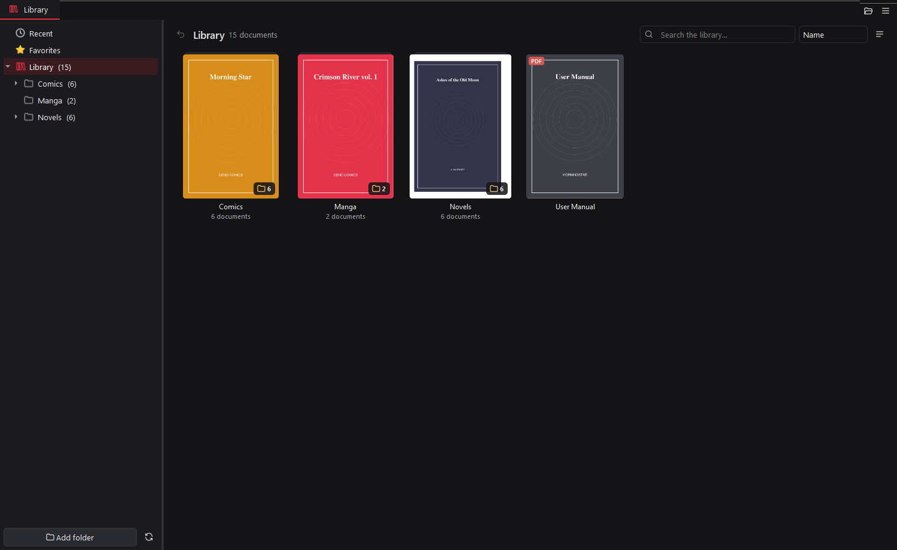
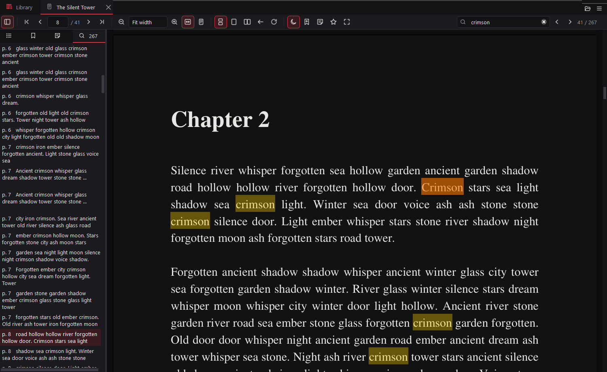
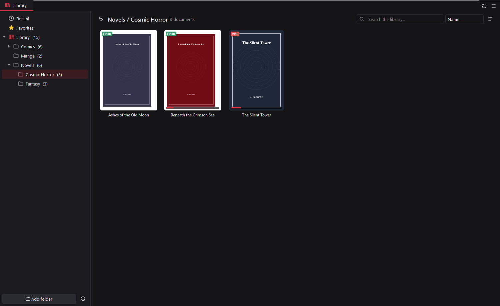
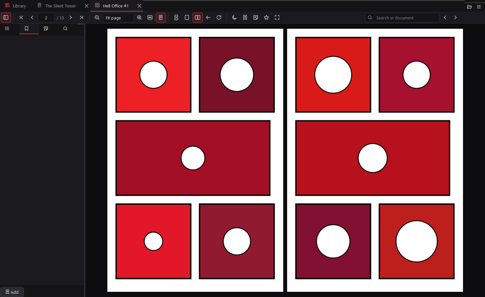
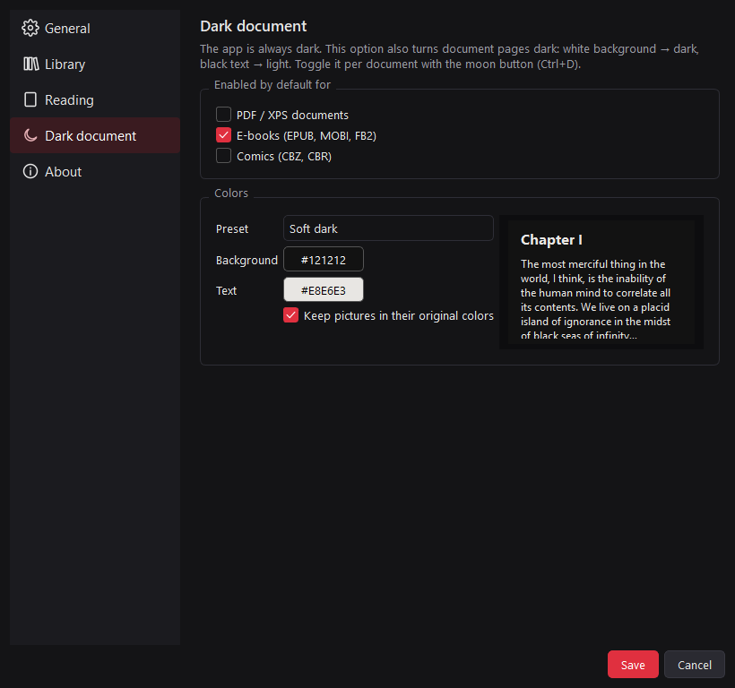
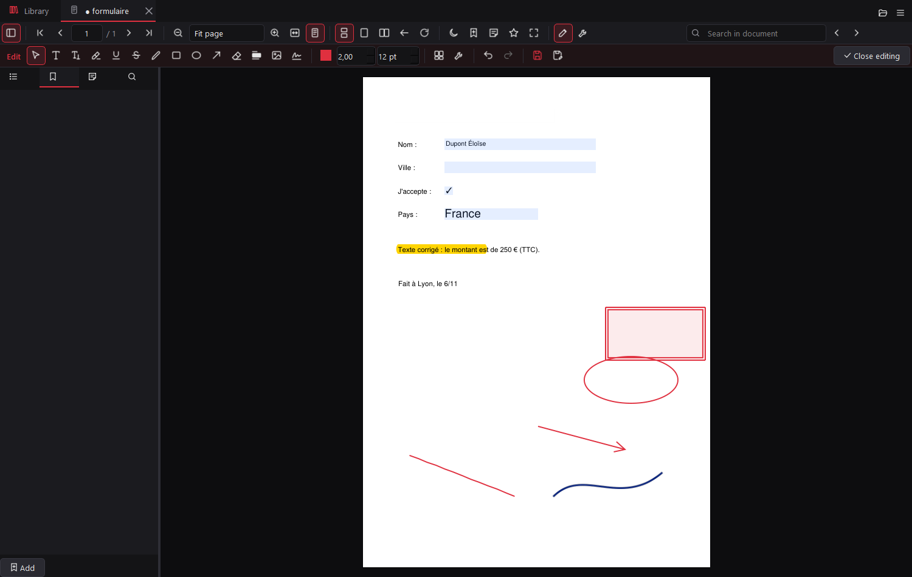
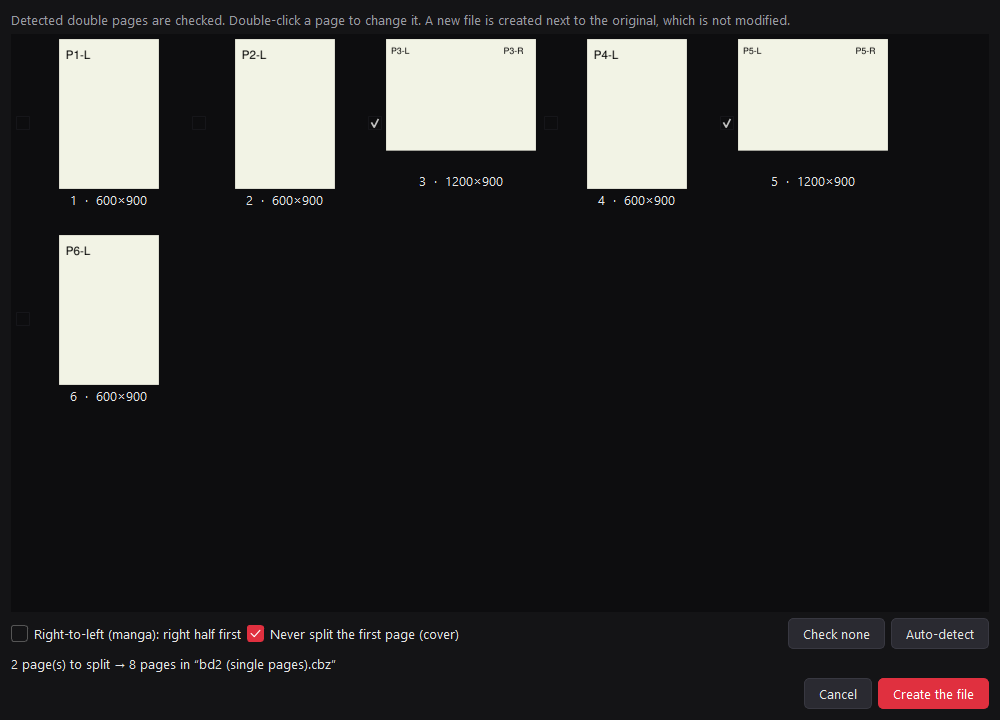
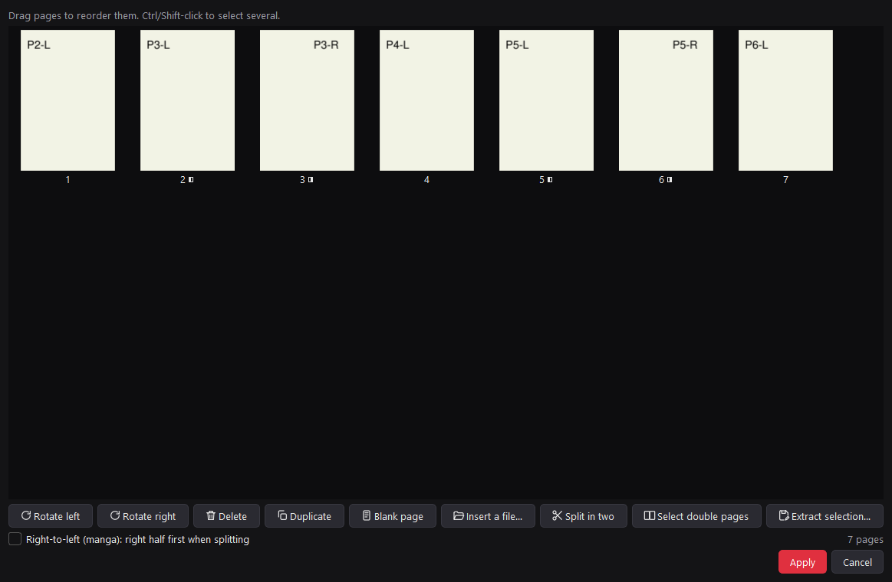

<p align="center">
  
</p>

<h1 align="center">Morningstar Reader</h1>

<p align="center">
  A fast, <b>always-dark</b> PDF / EPUB / comic reader <b>and editor</b> for Windows,<br>
  with a library that keeps <b>your</b> folder structure.
</p>

<p align="center">
  
  
  
  
</p>



## Why another reader?

Most readers either handle PDFs well or comics well, and their libraries throw every file into one big pile.
Morningstar Reader opens **PDF, EPUB and comics in the same window**, and its library mirrors the folders you
already have:

```
00_Comic and Ebook\Novels\Lovecraft\...      →  Novels / Lovecraft
00_Comic and Ebook\BD\00_Marvel\Hulk (2002)\  →  BD / Marvel
```

## Features

### Reading
- **Formats:** PDF, EPUB, CBZ, CBR (RAR *and* mis-named ZIP), MOBI, FB2, XPS/OXPS, rendered by MuPDF.
- **Layouts:** continuous scrolling, single page (page by page), and two pages side by side with an optional
  standalone cover. Comics also have right-to-left (manga) mode.
- **Zoom:** fit width, fit page, actual size, preset levels, any typed value, and Ctrl + mouse wheel zoom
  centered on the cursor. Rotation is available too.
- **Search** in the document, with highlighted hits, F3 / Shift+F3 navigation and a result list with context.
  The search runs in small chunks, so the UI never freezes, even on 3,000+ page books.
- **Table of contents** (PDF outline / EPUB navigation), clickable internal links, and external links that open
  in your browser.
- **Bookmarks:** named automatically after the current chapter, renamable, and shown as a red ribbon on the page.
- **Notes:** sticky notes pinned anywhere on a page. They're listed in the side panel and shown as a tooltip when
  you hover them. Notes are stored by the app, so your files are never modified.
- **Text selection** and copy, by dragging or double-clicking a word.
- **EPUB text size** (A− / A+). Your reading position survives the re-layout.
- **Tabs**, full screen (F11), drag & drop. A single instance: opening a file from Explorer reuses the open window.
- Your **position is remembered** for every document, and you can reopen your last session.

### Dark everything
- The interface is **always dark**.
- **Dark document mode** (moon button / Ctrl+D) turns white pages dark and black text light, which is ideal for
  PDF books. It's toggled per document and remembered.
- In the settings you can choose the background and text colors (with presets such as *Soft dark*,
  *Pure black (OLED)*, *Sepia night* and *Hellfire*), and whether **pictures keep their original colors**.
  Scanned pages are still inverted. You can also enable dark mode by default for PDFs, e-books or comics.



### Library
- Add one or more folders. **Each sub-folder becomes a category**, shown as a tree and as folder tiles with a
  cover.
- **Numeric prefixes are hidden** (`00_Marvel` → `Marvel`). **Folders that contain a single document are merged**
  into their parent, so a comic in `Hulk - The End (2002)\` shows up directly in *BD / Marvel*. Both options can be
  turned off.
- **Recent** files (with reading progress bars) and **Favorites** (star any document).
- Instant search across the whole library, a flat view of all sub-folders, and sorting by name (natural order:
  *#2* comes before *#10*), date or size.



### Built for big libraries (50 GB+)
- Folder scanning only reads file metadata. It runs in a background thread and is stored in a SQLite index, so
  the app starts instantly with a library of thousands of files.
- **Covers are generated lazily**, only for the tiles you actually see, by a pool of background *processes*
  (newest request first). They're cached as small JPEGs.
- Pages are rendered as **tiles** with a low-resolution preview first. Only the visible area and its surroundings
  are rendered, with a bounded memory cache. Huge PDFs open in milliseconds.
- RAR comics are read with the `tar.exe` (libarchive) **built into Windows 10/11**, so nothing extra is needed.
  7-Zip or UnRAR are used if they're installed. Converted archives are cached (4 GB LRU).

| Comics (two-page mode) | Settings |
|---|---|
|  |  |

### Editing (Ctrl+E)
Press **Edit** in a document's toolbar to open a second toolbar with editing tools:

- **Fill in PDF forms.** Click a field to type, or tick checkboxes and pick list values. This works even outside
  edit mode, and fields are highlighted.
- **Add text** anywhere, for forms without fields. The text is a movable, editable annotation.
- **Edit existing text.** Click a line, then change its wording, size, color or font. The old text is removed
  and the new text is written with an embedded TrueType font, so €, œ and other accents work.
- **Highlight, underline and strike out** text by selecting it.
- **Draw** freehand, and add **rectangles, ellipses and arrows**, with a color and line width of your choice.
- **Signature:** draw it once or load an image. It's kept for later and placed by clicking or dragging.
- **Images:** insert, replace, extract, or delete them, on one page or on every page where the image appears.
- **White-out** an area, or **redact** it in black. Both permanently remove the text and images underneath.
- **Select an object** to move it (text boxes and shapes), restyle it, or delete it with the Del key.
- **Organize pages:** reorder by drag & drop, rotate, delete, duplicate, add blank pages, insert other files
  (PDF, EPUB, comics, images), **split double pages in two**, and extract a selection to a new PDF.
- **Document menu:** compress on save, set or remove a **password** (AES-256), edit the title and author, and
  flatten annotations and forms.
- **Undo / redo** (Ctrl+Z / Ctrl+Y) for every change. An unsaved document shows **●** in its tab, and you're asked
  before closing it.
- **Save (Ctrl+S)** replaces the file and **keeps the original next to it as `name.pdf.bak`**. The first original
  is never overwritten by later saves. **Save as** writes a copy instead. Use **Menu → Backups (.bak)** to restore
  a backup or purge old ones.
- **Comics (CBZ/CBR)** can be edited the same way (pages, drawings, images). They're saved back as CBZ, and
  untouched pages keep their original JPEG/PNG files byte for byte. E-books (EPUB, MOBI, FB2) can't be edited
  directly: the app offers to convert them to a new PDF and opens that one in edit mode.



### Tools
- **Split double pages.** Landscape pages are detected automatically, and you get a preview where you choose which
  pages to cut. You can keep the cover whole and use right-to-left order for manga. The result is a **new file**
  (`… (single pages).cbz/pdf`) and the original is never touched. You can cancel at any time before the end.
  PDF pages are cut losslessly. It also works **in batch** on a whole folder (right-click it in the library).
- **Convert** any supported format to **PDF**, **EPUB** or **CBZ**, one file, several files or a whole folder,
  in the background with progress and cancel:
  - **EPUB** can be *reflowable text* (for novels; keeps chapters and images) or *fixed layout* (one image per
    page, for comics and scans). *Automatic* picks the right mode.
  - **CBZ** keeps the original image of scanned / comic PDF pages when possible, and renders the other pages at
    the DPI and JPEG quality you choose.
  - **CBR** output needs WinRAR (`rar.exe`), because the RAR format can only be created by WinRAR. The option is
    disabled when it's missing.
- **Merge** several files (any format) into one PDF (with one bookmark per file) or one CBZ.

| Split double pages | Organize pages |
|---|---|
|  |  |

## Download

1. Grab `MorningstarReader-x.y.z-windows-x64.zip` from the
   [**Releases**](https://github.com/Sydde01/Morningstar-reader/releases) page.
2. Extract it anywhere and run `MorningstarReader.exe`.
3. *(Optional)* Right-click a PDF / EPUB / CBZ, then **Open with → Choose another app**, and pick
   `MorningstarReader.exe`.

> The executable isn't code-signed, so Windows SmartScreen may warn on first launch
> (**More info → Run anyway**).

## Run from source

```powershell
git clone https://github.com/Sydde01/Morningstar-reader.git
cd Morningstar-reader
python -m venv .venv
.venv\Scripts\pip install -r requirements.txt
.venv\Scripts\python main.py            # or: python -m morningstar
```

Build the standalone version (output in `dist\`):

```powershell
powershell -ExecutionPolicy Bypass -File build.ps1
```

Need test files? `python tools/make_demo_library.py demo-library` creates a small fake library (PDF, EPUB, CBZ).

## Keyboard shortcuts

| Keys | Action |
|---|---|
| `Ctrl+O` / `Ctrl+W` / `Ctrl+Tab` | Open file / close tab / next tab |
| `Ctrl+L` | Library |
| `Ctrl+F`, `F3`, `Shift+F3` | Search, next / previous result |
| `Ctrl+G` | Go to page |
| `Ctrl +` / `Ctrl -` / `Ctrl+wheel` | Zoom |
| `Ctrl+0` / `Ctrl+1` / `Ctrl+2` | Fit page / actual size / fit width |
| `Ctrl+6` / `Ctrl+7` / `Ctrl+8` | Single page / two pages / continuous |
| `Ctrl+D` | Dark document on / off |
| `Ctrl+B` / `Ctrl+Shift+N` | Add bookmark / add note |
| `Ctrl+R` | Rotate |
| `Ctrl+C` | Copy selected text |
| `F11` / `F12` | Full screen / side panel |
| `←` `→` `PgUp` `PgDn` `Space` `Home` `End` | Navigate |
| `Alt+drag`, middle-drag | Pan |
| `Ctrl+E` | Edit mode |
| `Ctrl+S` / `Ctrl+Shift+S` | Save (keeps a `.bak`) / save as |
| `Ctrl+Z` / `Ctrl+Y` | Undo / redo |
| `Del` / `Esc` | Delete the selected object / back to the selection tool |

## Where is my data?

| What | Where |
|---|---|
| Settings, library index, bookmarks, notes, reading positions | `%APPDATA%\MorningstarReader\` |
| Saved signatures | `%APPDATA%\MorningstarReader\signatures\` |
| Cover cache, converted CBR archives | `%LOCALAPPDATA%\MorningstarReader\` (can be cleared from the settings) |
| Backups of edited files | next to each file, as `name.ext.bak` (listed in **Menu → Backups**) |

Reading never modifies your documents. A file is only rewritten when you **save** it in edit mode, and the original
is kept as `.bak` until you purge it.

## Limitations

- DjVu, AZW3/KFX and DRM-protected e-books aren't supported (MuPDF limitation).
- Reading notes and bookmarks are stored by the app, not written into the PDF. Use edit mode to add real PDF
  annotations.
- Editing existing text works line by line and uses Arial, Times or Courier, which may differ slightly from the
  document's own font.
- XFA forms (an old Adobe format) and certificate-based digital signatures aren't supported.
- No OCR for scanned documents yet.

## Project layout

```
morningstar/
  app.py            main window, tabs, single instance, session
  library.py        library tree + cover grid
  scanner.py        background folder scan → SQLite
  thumbs.py         cover generation in a process pool
  canvas.py         page viewport: layout, tiled rendering, zoom, selection, links
  viewer.py         document tab: toolbar, contents, bookmarks, notes, search
  editor.py         edit mode: tools, forms, signature, undo/redo, save with .bak
  pages_dialog.py   page organizer
  tools_dialogs.py  convert / split double pages / merge / backups dialogs
  convert.py        conversion, splitting and merging engine (runs in a worker process)
  jobs.py           background process runner with progress and cancel
  editing.py        saving helpers, .bak handling, fonts
  docbackend.py     MuPDF opening, CBR support, dark-page filter
  settings_dialog.py, theme.py, icons.py, i18n.py, translations_fr.py, db.py, config.py
tools/              icon generator, demo-library generator
```

## Icon

The icon designs in [`assets/icon-proposals`](assets/icon-proposals) are original artwork inspired by the mood of
the game *Helltaker* (by vanripper). This project isn't affiliated with or endorsed by its author. Regenerate them
with `python tools/make_icons.py --choose N`.

## License

[AGPL-3.0](LICENSE). Morningstar Reader is built on [PyMuPDF / MuPDF](https://github.com/pymupdf/PyMuPDF) (AGPL)
and [Qt for Python (PySide6)](https://doc.qt.io/qtforpython/) (LGPL).
